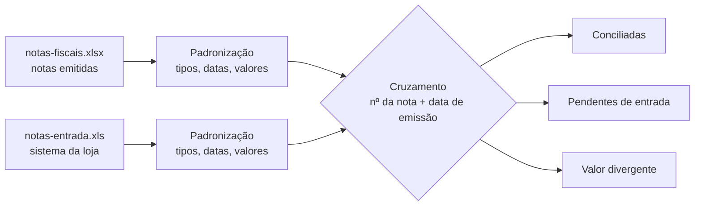
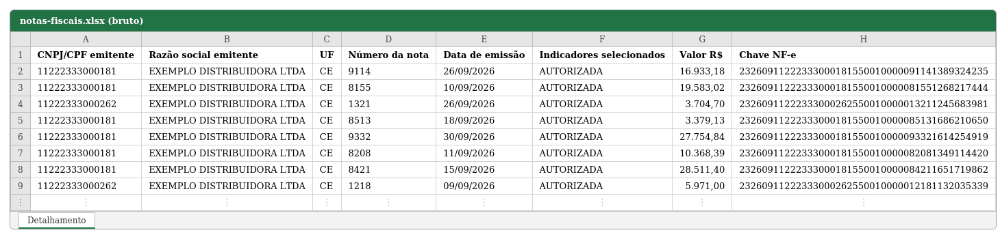
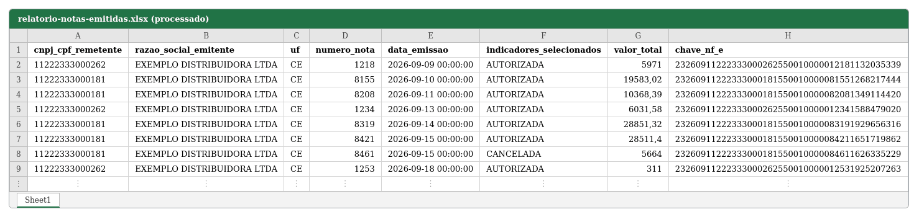
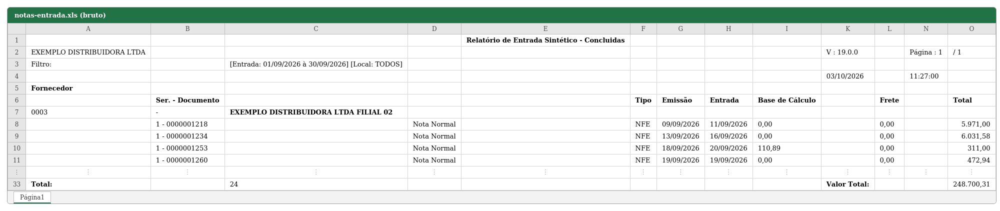
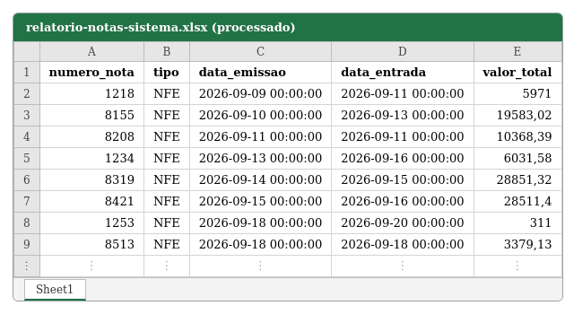
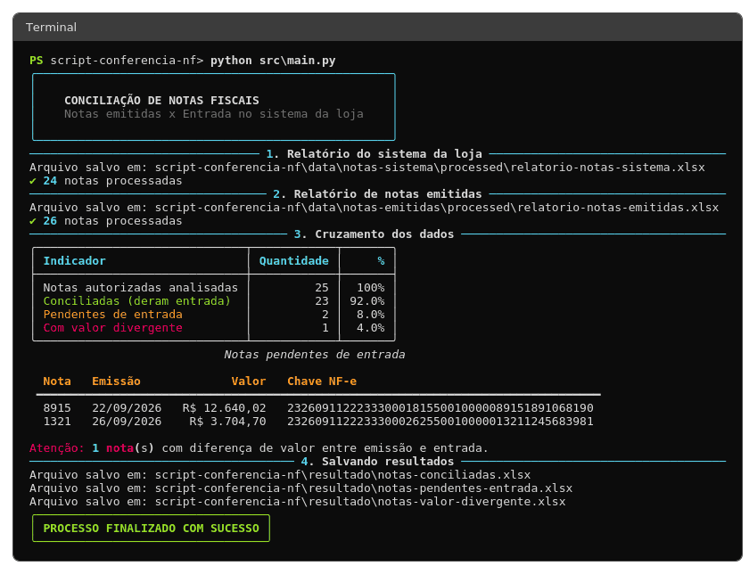
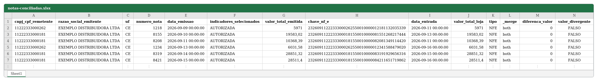
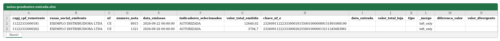
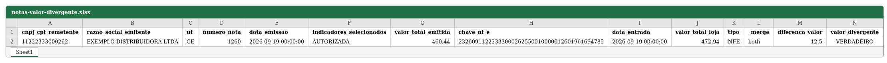

# Conciliação de Notas Fiscais

Script em Python que confere se as **notas fiscais emitidas** (NF-e) por uma empresa foram **lançadas no sistema da loja** que as recebe. Ele lê dois relatórios em Excel, padroniza os dados, cruza as informações e gera três relatórios de resultado: notas conciliadas, notas pendentes de entrada e notas com valor divergente.


---

## Sumário

- [O problema](#o-problema)
- [Objetivo](#objetivo)
- [Como funciona](#como-funciona)
- [Demonstração](#demonstração)
  - [1. Relatório de notas emitidas](#1-relatório-de-notas-emitidas)
  - [2. Relatório do sistema da loja](#2-relatório-do-sistema-da-loja)
  - [3. Execução no terminal](#3-execução-no-terminal)
  - [4. Resultados](#4-resultados)
- [Regras do cruzamento](#regras-do-cruzamento)
- [Estrutura do projeto](#estrutura-do-projeto)
- [Como executar](#como-executar)
- [Testes automatizados](#testes-automatizados)
- [Decisões e desafios](#decisões-e-desafios)
- [Dados de exemplo](#dados-de-exemplo)
- [Próximos passos](#próximos-passos)

---

## O problema

Quando uma loja compra de um fornecedor, o fornecedor emite uma NF-e e a loja precisa **dar entrada** dessa nota no próprio sistema. Conferir manualmente se cada nota emitida foi lançada, e com o valor certo, é um trabalho repetitivo e sujeito a erro: uma nota esquecida pode gerar problema fiscal e financeiro.

Os dados vêm de duas fontes que não conversam entre si:

| Fonte | Formato | O que traz |
|---|---|---|
| Relatório de **notas emitidas** | `.xlsx` | Todas as notas emitidas pelo fornecedor, com chave de acesso e status |
| Relatório de **entrada do sistema da loja** | `.xls` (legado) | Notas efetivamente lançadas no sistema, com data de entrada e valor |

## Objetivo

Automatizar a conciliação entre as duas fontes e responder, em segundos:

- Quais notas emitidas **ainda não deram entrada** no sistema?
- Quais deram entrada com **valor diferente** do emitido?
- Quais estão **conciliadas** sem nenhuma diferença?

## Como funciona



1. **Leitura:** cada relatório é lido com o motor adequado (`openpyxl` para `.xlsx`, `xlrd` para `.xls`), ignorando cabeçalho e rodapé do relatório do sistema.
2. **Padronização:** nomes de colunas em `snake_case`, número da nota como inteiro, datas como `datetime` e valores no formato brasileiro (`33.720,00`) convertidos para número.
3. **Cruzamento:** `merge` das notas emitidas com as notas do sistema.
4. **Resultado:** três planilhas separadas e um resumo no terminal.

---

## Demonstração

> Todas as imagens abaixo foram geradas com **dados fictícios** (ver [Dados de exemplo](#dados-de-exemplo)). As tabelas mostram as primeiras linhas.

### 1. Relatório de notas emitidas

**Antes** (arquivo bruto, como vem da origem):



**Depois** (colunas renomeadas, datas e valores convertidos, ordenado por data):



### 2. Relatório do sistema da loja

**Antes** (relatório `.xls` exportado pelo sistema, com cabeçalho, filtros, agrupamento por fornecedor e rodapé):



**Depois** (somente as colunas necessárias, uma nota por linha, tipos corretos):



### 3. Execução no terminal

A saída usa a biblioteca [`rich`](https://github.com/Textualize/rich) para mostrar o andamento de cada etapa, um resumo do cruzamento e a lista de notas pendentes.



### 4. Resultados

**Notas conciliadas** (deram entrada no sistema):



**Notas pendentes de entrada** (emitidas, autorizadas e sem lançamento no sistema):



**Notas com valor divergente** (entraram, mas com valor diferente do emitido):



---

## Regras do cruzamento

- **Chave composta:** `numero_nota` + `data_emissao`. O número sozinho pode se repetir entre filiais; a data reduz o risco de casar notas que não têm relação. O relatório do sistema não traz CNPJ, por isso ele não entra na chave.
- **Somente notas `AUTORIZADA`:** notas canceladas não precisam de entrada e não aparecem como pendentes.
- **Valor fora da chave:** uma diferença de centavos não pode esconder a nota; o valor é comparado depois do cruzamento.
- **Tolerância de R$ 0,01** na comparação de valores, para evitar falsos positivos de arredondamento.
- **Duplicidade acusada:** o `merge` usa `validate='1:1'`, então uma nota repetida na chave interrompe o processo em vez de duplicar linhas em silêncio.
- **Valor inválido interrompe:** se algum valor não puder ser convertido em número, o cruzamento levanta um erro com mensagem clara.

## Estrutura do projeto

```
script-conferencia-nf/
├── data/
│   ├── notas-emitidas/
│   │   ├── raw/                  # relatório original (.xlsx)
│   │   └── processed/            # relatório padronizado
│   └── notas-sistema/
│       ├── raw/                  # relatório original (.xls)
│       └── processed/            # relatório padronizado
├── resultado/                    # conciliadas, pendentes e divergentes
├── docs/img/                     # imagens usadas neste README
├── notebooks/                    # análise exploratória
├── src/
│   ├── config.py                 # caminhos do projeto
│   ├── formatacao_arquivo.py     # leitura e padronização
│   ├── cruzamento.py             # cruzamento e conferência de valores
│   ├── utils.py                  # formatação e tabelas do terminal
│   └── main.py                   # orquestra o fluxo completo
├── tests/                        # testes automatizados (pytest)
├── executar.bat                  # atalho para rodar no Windows
├── pyproject.toml
└── requirements.txt
```

Cada módulo tem uma responsabilidade: `config` guarda caminhos, `formatacao_arquivo` trata os dados, `cruzamento` aplica as regras de negócio e `main` só orquestra. Isso permite testar cada parte isoladamente.

## Como executar

**Requisitos:** Python 3.11 ou superior (desenvolvido com 3.13).

```bash
# 1. Clone o repositório
git clone <url-do-repositorio>
cd script-conferencia-nf

# 2. Crie e ative um ambiente virtual
python -m venv .env
.env\Scripts\activate          # Windows
# source .env/bin/activate     # Linux/macOS

# 3. Instale as dependências
pip install -r requirements.txt

# 4. Execute
python src/main.py
```

No Windows, também é possível dar dois cliques em **`executar.bat`**, sem abrir editor ou terminal. A janela só fecha quando você pressionar uma tecla.

Os relatórios de entrada devem estar em:

- `data/notas-emitidas/raw/notas-fiscais.xlsx`
- `data/notas-sistema/raw/notas-entrada.xls`

Os resultados são gravados na pasta `resultado/`. Feche as planilhas no Excel antes de executar novamente, senão o Windows impede a gravação.

## Testes automatizados

```bash
pytest
```

São **32 testes** cobrindo os casos que mais costumam dar errado:

| Módulo | O que é testado |
|---|---|
| `cruzamento` | nota conciliada e pendente, nota cancelada ignorada, mesmo número com data diferente, diferença de R$ 0,01 dentro da tolerância, valor divergente, duplicidade na chave, valor em texto, valor que não converte |
| `formatacao_arquivo` | valores no formato brasileiro (`33.720,00`, `241,73`, `R$ 820,00`), valor vazio, número da nota com texto, datas inválidas, ordem dia/mês, DataFrame original preservado |
| `utils` | formatação de moeda em reais |

## Decisões e desafios

Alguns problemas reais encontrados no caminho e como foram resolvidos:

**Chave de acesso virando notação científica.** A chave da NF-e tem 44 dígitos, mas um `float` guarda só cerca de 15 a 17 dígitos significativos. Se a coluna for lida como número, os últimos dígitos se perdem e não é possível recuperá-los. A solução é ler com `dtype=str`, e só converter para número o que realmente é numérico.

**Valores no formato brasileiro.** O sistema da loja exporta `1.234,56`. Uma limpeza ingênua (`[^\d.]`) apagava a vírgula e mantinha o ponto, transformando `33.720,00` em `33.72` e `241,73` em `24173`, sem nenhum erro. A conversão correta remove o ponto de milhar e troca a vírgula decimal por ponto. Esse caso virou teste automatizado.

**Falha silenciosa.** O bug acima só apareceu ao comparar os valores dos dois relatórios no resultado do `merge`. Por isso o cruzamento agora valida os tipos antes de comparar e interrompe com uma mensagem clara quando algum valor não converte.

**Tipos diferentes na chave.** O número da nota vinha como texto em uma tabela e como inteiro na outra, e o `merge` não encontrava correspondências. Ambos são convertidos para `Int64` antes do cruzamento.

**Funções com efeito colateral.** As funções de tratamento recebem e devolvem `DataFrame`, sem ler ou gravar arquivos por conta própria. Só a etapa final grava em disco, o que evita releituras e facilita os testes.

## Dados de exemplo

Os arquivos em `data/` e `resultado/` são **fictícios**: empresa, CNPJs e valores foram inventados. Os CNPJs têm dígitos verificadores válidos e as chaves de acesso seguem a composição real da NF-e (UF, ano/mês, CNPJ, modelo, série, número, código e dígito verificador), mas não correspondem a nenhuma nota existente.

Os dados de exemplo incluem de propósito casos para demonstrar o cruzamento: uma nota cancelada, duas pendentes de entrada, uma com valor divergente e uma lançada no sistema sem correspondência nas emitidas.

> **Atenção:** ao usar o projeto com dados reais, mantenha os arquivos reais fora do repositório (`.gitignore`) e limpe a saída dos notebooks antes de publicar.

## Próximos passos

- [ ] Tratamento de exceções específicas (arquivo ausente, arquivo aberto no Excel, layout do relatório alterado)
- [ ] Registro em arquivo com `logging`
- [ ] Seleção automática do arquivo `.xlsx` mais recente da pasta
- [ ] Relatório final em um único Excel com abas
- [ ] Execução dos testes automaticamente com GitHub Actions
- [ ] Cruzamento inverso: notas lançadas no sistema sem correspondência nas emitidas
